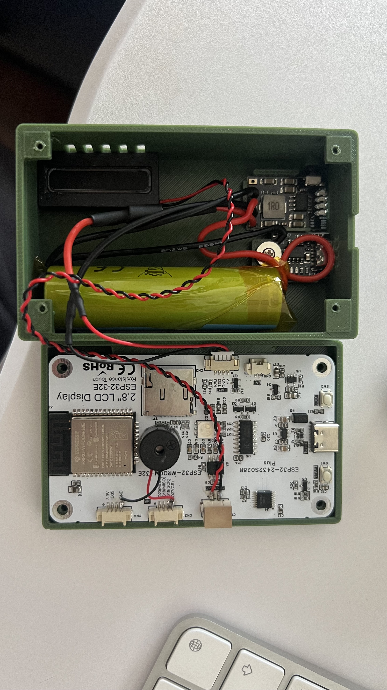

# CW Trainer

[](https://github.com/Johnson-LYS/esp32-cw-trainer/actions/workflows/ci.yml)
[](LICENSE)

A Morse code (CW) trainer firmware for the ESP32-2432S028R "cheap yellow display"
board — Koch method training, callsign copying, simulated QSOs, a touch paddle
keyer with live decoding, and networked practice over the MorseKOB/CWCom
protocol. Built with ESP-IDF and LVGL. Flash a prebuilt image from
[Releases](../../releases), or build it yourself — the rest of this README is in
Chinese.

---

ESP32-2432S028R（2.8" 电阻触摸屏 + 18650 电池的便携盒子，玩家圈里叫 CYD）上的
莫尔斯电码练习机固件。离线可用，联网可对练。



## 功能

- **Koch 听写训练** —— 39 课，从 K/M 两个字母起步，每课加一个字符；Farnsworth
  间距，默认字符速度 20 WPM / 有效速度 15 WPM
- **呼号抄收** —— 四选一，干扰项按莫尔斯听感易混字符生成（S/H、U/V、E/I、N/M 等）
- **模拟 QSO** —— 定向呼叫整句，抄对方呼号和 RST
- **电键练习** —— 触摸桨（Iambic A/B / 直键）或外接电键，实时侧音 + 实时解码显示
- **手法分析** —— 点划时长、字符间隔的统计与偏差
- **联网对练** —— MorseKOB / CWCom 协议，和真人在一条 wire 上互发
- **OTA 升级** —— 设置里检查更新，双槽 OTA，升级不丢设置与进度

进度和设置存在 NVS，掉电不丢。

## 烧录

不想装工具链就直接用 [Releases](../../releases) 里的分发包，里面有合并镜像、
分段镜像、校验和与烧录说明。串口按实际值改（`ls /dev/cu.usb*` 查看）：

```bash
# 整机烧录（首次使用，会清空设置和进度）
python -m esptool --chip esp32 -b 460800 -p /dev/cu.usbserial-XXXX \
  write_flash 0x0 cw-trainer-<版本>-合并版.bin
```

保留设置的升级烧录方式见包内 `README.md`。

## 从源码构建

需要 **ESP-IDF v5.5.4**（安装步骤见 `docs/build-setup.md`）：

```bash
git clone https://github.com/Johnson-LYS/esp32-cw-trainer.git
cd esp32-cw-trainer
tools/idf.sh build
tools/idf.sh flash monitor
```

`tools/idf.sh` 只是替你 source 一次 `export.sh` 再转发给 `idf.py`。已经在 IDF
环境里（比如 CI 容器）直接 `idf.py build` 即可。

串口默认值 `/dev/cu.usbserial-310` **不是通用值**，只是某一台开发机上的实测
结果——换机器、换线基本都会变。先 `ls /dev/cu.usb*` 看看自己的，再用环境变量
覆盖，不必改脚本：

```bash
ESP_PORT=/dev/cu.usbserial-XXXX tools/idf.sh flash monitor
```

## 外接电键接线

CN3 / CN4 是 1.25mm **4P** 卧式座子（和板背面 CN2 串口座同一颗料），不是 2.54
排针，需要 1.25mm 4P 端子线各一条。CN3 丝印顺序
`IO27(CS) IO18(SCK) IO19(MISO) IO23(MOSI)`；CN3 没有电源和地，地从 CN4
（`GND / IO35 / 3.3V`）引。

| | 面包板按键 | 3.5mm TRS 成品电键 |
|---|---|---|
| 点 | CN3 脚2 = IO18 | **Tip** → IO18 |
| 划 | CN3 脚4 = IO23 | **Ring** → IO23 |
| 地 | CN4 脚1 = GND | **Sleeve** → GND |

低电平有效、内部上拉，**不需要任何外接元件**。没有「启用外接电键」这个开关——
触摸桨和外接口是并联的，两路谁按都算。插反了不用重焊：设置 → 电键 → 桨键左右
对调。

母座焊片没有统一丝印，**必须插着插头用万用表通断档量**；当心五脚母座那两个常
闭触点。详细道理、选脚理由（为什么是 IO18/IO23 而不是别的）和「一根线恒为低时
会怎样」的门闩机制，见 `docs/engineering-notes.md`。

完整引脚表见 `docs/hardware.md`。

## 联网对练

主页「联网对练」进入，没配过网会自动跳配网页。

默认服务器 `8.138.130.141:7890`（UDP），wire 11 —— 自建在阿里云广州。不接国际
公共 wire 的理由是实测数据：国际线路 UDP 丢包 17~24%，而 CWCom 协议每字符一个
包、无重传，等于每五个字符消失一个；自建实测 0% 丢包、30ms。

WiFi **默认关闭**，只在配网页和对练页临时开启，退出即 `esp_wifi_deinit()`——
侧音走内置 DAC 是模拟输出，WiFi 电流尖峰会窜成底噪，而离线练习是主线场景。

协议实现的踩坑记录见 `docs/engineering-notes.md`「联网对练」。

## 结构

```
main/core/     莫尔斯表、时序、电键状态机、解码器、Koch 引擎、呼号生成、
               练习会话、CWCom 协议——纯 C，不含任何 ESP-IDF 依赖
main/*.c       侧音（I2S 内置 DAC）、文本发报、电键输入、NVS、OTA、WiFi、电量、背光
main/ui/       LVGL 页面：主页、预告、练习、结算、电键、对练、设置、统计
test/          主机测试。core/ 不依赖 ESP-IDF，正是它们能在主机上直接跑的原因
components/    vendored LVGL 8.3.11 + ST7789/XPT2046 驱动 + 移植层 + 字体
tools/         构建、烧录、发布、字体裁剪、资源生成脚本
docs/          硬件参考、构建环境、发布流程、设计文档、版本说明、工程笔记
```

## 开发

```bash
make -C test      # 14 个测试程序、133 个用例，全部通过、编译无警告
```

改了中文文案之后要重新裁剪字库，否则新字会静默渲染成空白：

```bash
python3 tools/check_charset.py    # 构建前自检，用到表外字符直接报错
```

CI 在每次 push 跑主机测试、静态自检和一次完整构建；打 `v*` tag 会构建、打包并
创建 Release（见 `.github/workflows/`）。发布规则见 `docs/release-process.md`。

**`docs/engineering-notes.md` 值得先读一遍**——里面是踩出来、且不写下来下次
一定会再踩一遍的坑：侧音采样率为什么不能往下调、含中文的 label 用错字体会静默
变空白、屏幕旋转必须改两处、外接电键的选脚理由。

## 请我喝杯咖啡

业余时间写的，免费、开源、没有功能墙，也不打算有。如果它帮你练下了几课，或者
省了你从头写一遍的功夫，可以请我喝杯咖啡——完全自愿，不请也一样用。


## 许可

MIT，见 `LICENSE`。

固件在上游 [zhaozhengde/esp32-fmo-companion](https://github.com/zhaozhengde/esp32-fmo-companion)
（MIT）的驱动移植层之上起步，溯源见 `docs/upstream-source.md`。第三方组件、字体
的逐项出处与许可见 `NOTICE.md`——**其中三个字体的底层来源不明**，用在对字体授权
有严格要求的场合前请自行核实。

作者 BI8SYN。
